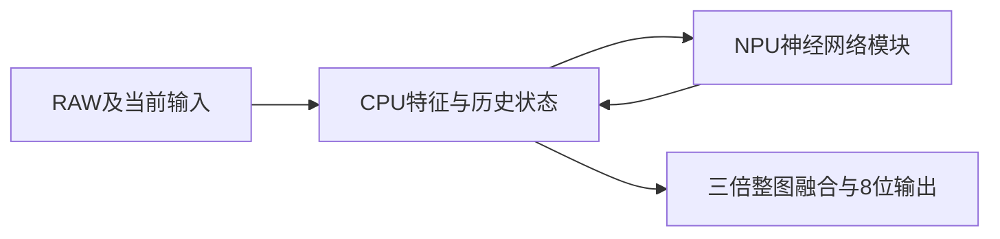

# 完整处理流程接入清单

本包的网络图使用PC上实际调用的张量作为输入。板端模块测速不执行原RAW预处理和跨帧CPU状态。

部署接入关系如下，CPU部分仍待ARM实现：

## 需保留的计算

| 部分 | 原实现入口 | 接入要求 |
| --- | --- | --- |
| RAW读取、归一化、参考构造 | `source/runtime/prepare_motion14.py`及原数据读取路径 | 使用各景当前配置及因果历史，保持已声明的输入帧顺序 |
| RAW运动与物理前景 | `source/runtime/physical_foreground95.py`及其父处理 | 保留过去观测、噪声估计、符号和当前目标判定 |
| 当前与旧位置跟踪、保护范围 | `source/runtime/body_current116.py`及目标跟踪、归属代码 | 保留轨迹关联、过去位置、道路范围及左侧保护区 |
| 背景网络专用调用 | `source/runtime/learned_background243.py`的`background` | 本包单独导出该Tensor计算，包含网络、有效区及局部平均处理 |
| 背景连通区域投影 | 同文件的`project` | 需要当前标签、有效背景及局部中位数；这段按数据改变的循环未放入静态ONNX |
| 多帧背景融合 | `source/runtime/quality_background298.py`及`background_temporal295.py` | 保留当前和过去四帧的可用背景观测；九个输出采样位置分别维护状态 |
| 小目标修正范围与均值保持 | `source/runtime/project_shape330.py` | 只在当前小目标范围内修正，每个连通区域的修正均值为零 |
| 完整输出融合 | `source/runtime/quality_control43.py`的`lift_native`及各父控制器的`full` | 按原链路顺序融合，保持原尺度采样位置一致 |
| 场景选择与融合强度 | `source/run_snapshot/`内实际加载的选择文件 | 使用本包选择值，不把未混合的网络提议当成最终结果 |

`lift_native`把修正量插值到`3H−2 × 3W−2`，使用双线性和`align_corners=True`，再在下侧、右侧各复制填充2像素。它不是对原尺度结果直接放大。

## 状态和调用顺序

每个新片段先清空该片段状态。每帧只推进一次原始观测链路，辅助分支读取相同父结果。历史只使用当前和过去帧。新增输出不回写已有冻结父结果的历史。

`workloads/<场景>/val_frame_XXX.json`给出原流程对应帧的实际网络调用顺序。相同网络会按分块尺寸、采样位置和分支重复调用，接入时需保留这些次数。

背景分支原来通过`background`方法调用网络，而非调用该类的`forward`。本包通过`background_call_deploy.py`显式导出该方法；其后的标签投影仍属待移植部分。

## 完整帧速的测量

接通CPU部分后，按连续帧运行整个流程。分别记录RAW及参考准备、NPU调用、CPU多帧与标签处理、整图融合和8位输出时间。另用SDK profiler记录纯NPU任务时间。

模块测试时已经准备好特征和历史相关输入，因此不能用模块时间之和代替这条完整流程的实测，也不能据此声明画质已在板端复现。
